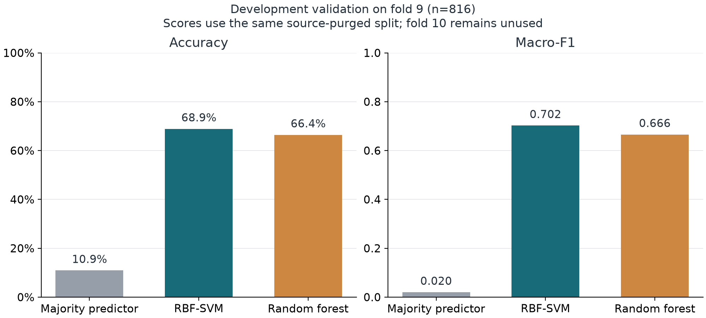

# Urban Sound Classification and Robustness to Noise

Machine Learning course project - **Milestone / development validation**.

We classify short environmental recordings into ten UrbanSound8K sound categories using 40 MFCC summary features. Following proposal feedback, our SVM uses an **RBF kernel**. We compare it with a random forest and a majority-class reference.

**Start here:** [one-page milestone report](03_评估与汇报/reports/Milestone_Report.pdf), [model results](02_模型训练/results/metrics.csv), [training code](02_模型训练/experiment.py), and [evaluation protocol](02_模型训练/results/protocol.json).

## Completed work and evidence

| Work completed | Inspectable evidence |
|---|---|
| Obtained all 8,732 WAV clips and verified archive/per-file checksums locally | [download receipt](01_数据处理与特征/data/download_receipt.json), [data audit](01_数据处理与特征/results/data_audit.json), [feature extraction code](01_数据处理与特征/extract_features.py) |
| Checked metadata, official folds and original recording-source IDs | [metadata validation](01_数据处理与特征/validate_metadata.py), [clip manifest](01_数据处理与特征/results/manifest.csv) |
| Extracted a finite 8,732 x 40 feature matrix locally | [feature configuration and feature hash](02_模型训练/results/protocol.json) |
| Compared three baselines; searched 9 SVM and 4 forest configurations | [search results](02_模型训练/results/search_results.json), [training code](02_模型训练/experiment.py) |
| Saved per-clip predictions, per-class scores and confusion matrices | [predictions](02_模型训练/results/predictions.csv), [per-class metrics](03_评估与汇报/results/per_class_metrics.csv), [figures](03_评估与汇报/reports/figures) |
| Reloaded the three trained models and independently reproduced predictions and metrics locally | [verification record](03_评估与汇报/results/verification.json), [verification script](03_评估与汇报/verify_results.py) |
| Passed 9 automated checks | [tests](03_评估与汇报/tests); run the quick-check command below |

The repository contains code, public metadata, experiment settings and recorded results. Raw audio, local environments, feature caches and trained model binaries are generated locally and are excluded from Git.

## Current results

All entries use the same 816 validation clips in official fold 9.

| Model | Validation accuracy | Validation Macro-F1 | Selected settings |
|---|---:|---:|---|
| Majority predictor | 10.91% | 0.0197 | Most frequent training class |
| RBF-SVM | **68.87%** | **0.7023** | C=10; gamma=scale |
| Random forest | 66.42% | 0.6656 | 200 trees; max_depth=20; min_samples_leaf=1 |

**These are model-selection validation scores, not independent test results.** We used this validation set to select hyperparameters. The learned-model ten-fold evaluation and added-noise experiments have not yet been performed. The results are not directly comparable with published ten-fold benchmark averages.



## Data and preprocessing

- **Dataset:** UrbanSound8K; 8,732 labeled WAV clips; 10 predefined folds; 10 classes. Clips are nominally at most four seconds (decoded durations in our audit: 0.05-4.04 s).
- **Classes:** air conditioner, car horn, children playing, dog bark, drilling, engine idling, gun shot, jackhammer, siren and street music.
- **Class sizes:** seven classes have 1,000 clips; siren has 929; car horn 429; gun shot 374.
- **Input normalization:** convert to mono and resample to 22,050 Hz. Only clips shorter than one analysis window are padded.
- **Features:** 20 MFCCs; n_fft=2048, hop_length=512, n_mels=128. Concatenate each coefficient's temporal mean and standard deviation to obtain 40 features per clip.
- **SVM scaling:** fit StandardScaler on training features only; apply that fitted scaler to validation features.

## Split and leakage controls

| Partition | Official folds | Clips |
|---|---|---:|
| Training | 1-8 after source-overlap exclusion | 7,000 |
| Model-selection validation | 9 | 816 |
| Reserved, unused by the main development experiment | 10 | 837 |
| Excluded from this training split | 79 clips from source 180937 | 79 |

We found source 180937 in both folds 1 and 9. Its 79 fold-1 clips are excluded from training; the original audio files are retained. The check uses **original recording-source IDs**, not only duplicate filenames. All models share this split, recorded in the [split manifest](02_模型训练/results/split_manifest.csv).

The fixed, label-only majority-baseline arithmetic test includes a historical ten-fold reference. It does not train or tune an audio classifier and is separate from the fold-9 comparison above. It is not evidence that final learned-model ten-fold evaluation is complete.

## Repository structure and team responsibilities

Keep these folders together: the scripts use paths relative to the repository root.

| Folder | Purpose | Responsibility |
|---|---|---|
| `00_公共支持/` | Shared paths, MFCC functions and dependencies | Shared |
| `01_数据处理与特征/` | Download, data validation and feature extraction | 孙煜皓 |
| `02_模型训练/` | Baselines, hyperparameter search and prediction records | 茅人方 |
| `03_评估与汇报/` | Evaluation, reproducibility checks, report and future noise experiments | 程志阳 |

The main training entry is `02_模型训练/experiment.py`. The shared `pipeline.py` also contains legacy utilities; use the documented commands below for the current source-checked milestone protocol.

## Reproduce the work

Our recorded environment uses **Python 3.12**. Exact package versions are in `00_公共支持/requirements-lock.txt`. The commands below run from the repository root in **PowerShell on Windows**.

### 1. Create the environment

```powershell
python -m venv .venv
.\.venv\Scripts\python.exe -m pip install -r '.\00_公共支持\requirements-lock.txt'
```

### 2. Quick checks without downloading audio

The public metadata and checksum index are included. These nine checks use metadata and a small synthetic audio example, so they do not require the 6 GB archive.

```powershell
.\.venv\Scripts\python.exe -m unittest discover -s '.\03_评估与汇报\tests' -v
```

### 3. Download and run the full milestone experiment

The official compressed archive is about 6.02 GB; reserve additional disk space for extracted audio, features and models. The downloader verifies the checksum and supports resuming an interrupted download. Training, feature extraction and verification run locally.

```powershell
.\.venv\Scripts\python.exe '.\01_数据处理与特征\download_dataset.py'
.\.venv\Scripts\python.exe '.\01_数据处理与特征\validate_metadata.py'
.\.venv\Scripts\python.exe '.\01_数据处理与特征\extract_features.py'
.\.venv\Scripts\python.exe '.\02_模型训练\experiment.py'
.\.venv\Scripts\python.exe '.\03_评估与汇报\analyze_results.py'
.\.venv\Scripts\python.exe '.\03_评估与汇报\verify_results.py'
```

An optional PowerShell wrapper, `run_milestone.ps1`, runs the same three stages. Use `-SkipDownload` only when the original audio is already complete. The Python commands above make each step explicit.

For a quick inspection of existing result figures, open `03_评估与汇报/reports/figures/`. `analyze_results.py` can regenerate these from the committed result tables without raw audio. `verify_results.py` requires the locally generated feature matrix and model files; its committed JSON is a record of the original run, not an automatic verification of a new checkout.

After running feature extraction and model verification, regenerate the report with:

```powershell
.\.venv\Scripts\python.exe -m pip install -r '.\00_公共支持\requirements-report.txt'
.\.venv\Scripts\python.exe '.\03_评估与汇报\build_report.py'
```

## Problems and next steps

1. **Source leakage:** related clips can share background acoustics and make validation look better than generalization to new environments. We audited source IDs and excluded 79 training clips. Future outer-fold evaluations need the same source checks in every split.
2. **Class imbalance:** Macro-F1 gives each class equal weight in evaluation; it does not change training sample counts. We have not yet tested whether class weighting or oversampling helps.
3. **Error interpretation:** RBF-SVM classified 43 of 100 validation air-conditioner clips as drilling. Similar spectra, background interference, and loss of temporal order in MFCC aggregation are hypotheses, not established causes. Next we will listen to errors and compare feature representations.
4. **Next experiments:** freeze the protocol, perform outer ten-fold evaluation with tuning restricted to each outer training partition, and test added white noise at 20, 10 and 0 dB SNR. Report variation across folds and per-class errors.

## Data sources and attribution

- [UrbanSound8K dataset](https://urbansounddataset.weebly.com/urbansound8k.html)
- [Official archive on Zenodo](https://doi.org/10.5281/zenodo.1203745)
- [Soundata checksum index](https://zenodo.org/records/11176928/files/urbansound8k_index_1.0.json?download=1)
- J. Salamon, C. Jacoby and J. P. Bello, *A Dataset and Taxonomy for Urban Sound Research*, ACM Multimedia, 2014.

The original dataset README and Freesound attribution list are retained in `01_数据处理与特征/data/UrbanSound8K/`. Consult them for the dataset's original non-commercial terms. Raw audio is obtained from its source rather than redistributed here.
